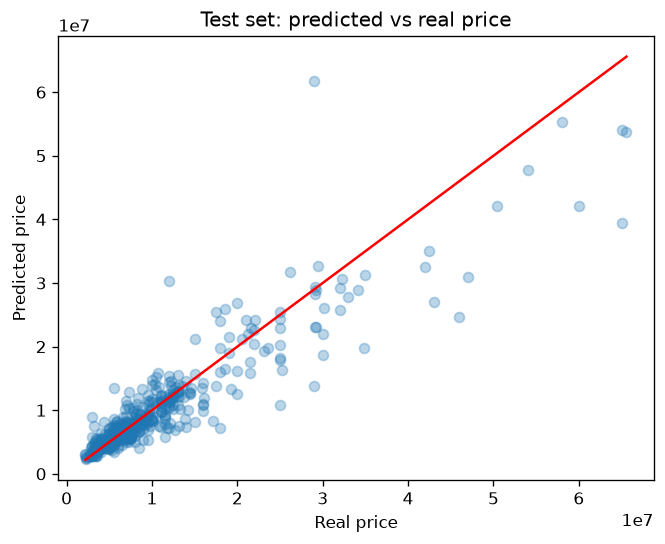
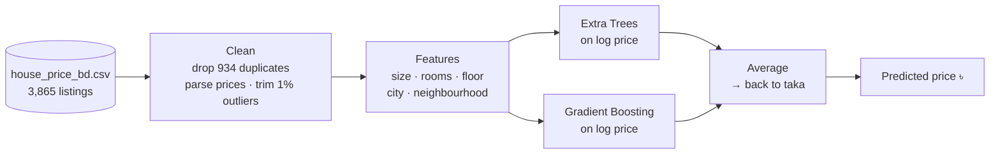

<div align="center">

# Bangladesh House Price Prediction

**Estimate what a flat, plot or shop in Bangladesh should cost — in taka, within about 15%.**

A clean, reproducible machine learning project: careful data cleaning, an honest evaluation that removes duplicate
listings, and an ensemble of two tree models trained on ~2,800 unique listings from five cities.




</div>

---

## Contents

- [Why this project](#why-this-project)
- [Highlights](#highlights)
- [Results](#results)
- [Quick start](#quick-start)
- [Predicting a price](#predicting-a-price)
- [How it works](#how-it-works)
- [Machine learning approach](#machine-learning-approach)
- [Project structure](#project-structure)
- [Limitations](#limitations)
- [Roadmap](#roadmap)
- [Author](#author)

## Why this project

Property prices in Bangladesh are hard to judge: a 3-bedroom flat is estimated at about ৳7M in Mirpur but
৳16M in Dhanmondi. This project builds a model that gives a fair estimate from a listing's basic facts, and shows the
steps that make such a model **trustworthy**:

- it **finds and removes duplicate listings** that would otherwise make the model look better than it is;
- it is **measured with 5-fold cross-validation**, not one lucky test split;
- it **compares against simple baselines**, so every gain is visible;
- it **reports the ideas that did not work**, not only the ones that did.

Use it as a learning reference for tabular regression, or as a starting point for a property price tool.

## Highlights

| | |
|---|---|
| 🎯 **~15% average error** | MAPE 15.1% and R² 0.821 across 5-fold cross-validation |
| 🧹 **Leakage caught** | 934 duplicate rows removed — without this the baseline would claim R² 0.888 instead of ~0.80 |
| 🌳 **Two-model ensemble** | Extra Trees + Histogram Gradient Boosting, averaged on a log-price scale |
| 🏙️ **Five cities** | Dhaka, Chattogram, Narayanganj, Gazipur and Cumilla, with neighbourhood-level location |
| 🏠 **Any property type** | Flats, plots, shops and buildings — missing room counts are kept as a signal |
| 📓 **One readable notebook** | Every step explained in plain language, executed with outputs |

## Results

Measured with **5-fold cross-validation on the de-duplicated data** (every listing is predicted once by a model that
never saw it):

| Model | Avg. error (MAE) | Avg. % error (MAPE) | R² |
|---|---|---|---|
| Random Forest (baseline) | ৳1.79M | 16.2% | 0.800 |
| **Extra Trees + Gradient Boosting** | **৳1.71M** | **15.1%** | **0.821** |

On a single held-out test set (20% of the data) the final model reaches **R² 0.840**, against 0.813 for the
Random Forest and 0.680 for linear regression.

> **Honest note on duplicates.** The raw file has 3,865 rows, but 934 are exact copies of another listing. When
> copies of the same flat sit in both the training and the test set, the model is graded on answers it has already
> seen: the original Random Forest scored R² 0.888 that way. Every number above is measured after removing them.

## Quick start

**Requirements:** Python 3.10+ and the dataset file `house_price_bd.csv` ([data/README.md](data/README.md)).

```bash
git clone https://github.com/Muktaditbf/bd-house-price.git
cd bd-house-price

python -m venv .venv
source .venv/bin/activate        # Windows: .venv\Scripts\activate
pip install -r requirements.txt

cp /path/to/house_price_bd.csv data/
jupyter notebook house_price.ipynb
```

Run all cells. Training takes under a minute on a laptop, and the last cells save the model to
`house_price_model.joblib`.

## Predicting a price

```python
predict_price(bedrooms=3, bathrooms=3, floor_no=5, floor_area=1500, city="dhaka", area="Dhanmondi")
# ৳16,127,543

predict_price(bedrooms=3, bathrooms=2, floor_no=4, floor_area=1200, city="dhaka", area="Mirpur")
# ৳7,251,013
```

| Argument | Meaning | Example |
|---|---|---|
| `bedrooms`, `bathrooms` | room counts (use `None` for a plot or shop) | `3` |
| `floor_no` | floor the property is on | `5` |
| `floor_area` | size in square feet | `1500` |
| `city` | `dhaka`, `chattogram`, `narayanganj-city`, `gazipur` or `cumilla` | `"dhaka"` |
| `area` | neighbourhood, as written in the listings | `"Dhanmondi"` |

## How it works



1. **Clean** — remove exact duplicate listings, turn `৳39,000,000` into a number, drop rows without a size or
   location, and trim the cheapest and most expensive 1% (mostly typos).
2. **Features** — floor area, bedrooms, bathrooms, floor number, city, and the neighbourhood taken from the last part
   of the address (`"Lake Circus Road, Kalabagan"` → `Kalabagan`), one-hot encoded.
3. **Model** — two tree ensembles each predict log(price); their average is converted back to taka.

## Machine learning approach

**Data.** 3,865 Bangladeshi property listings with size, rooms, floor, city, address and asking price
(see [data/README.md](data/README.md)). After cleaning: **2,787 unique listings**, 111 features.

**What improved the model**

| Change | Why it helps |
|---|---|
| Predict **log(price)** | Prices run from about ৳2M to over ৳100M; on a log scale a 10% miss counts the same for a small flat and a large one |
| Keep **missing room counts as missing** | Plots and shops have no bedrooms; filling the gap with a typical value hid that, while trees can learn from the gap itself |
| **Average two different models** | Extra Trees and Gradient Boosting make different mistakes, so their average beats either one |

**What did not help** (tested with the same cross-validation and left out):

- smoothed neighbourhood price-per-sq-ft encoding;
- a property-type feature (flat / plot / shop / building) parsed from the listing title;
- the `Occupancy_status` column — nearly every listing is `vacant`.

**Evaluation.** One fixed 80/20 split for the notebook walkthrough, plus 5-fold cross-validation for the headline
numbers. All models use `random_state=42`, so results are reproducible.

## Project structure

```
├── house_price.ipynb     cleaning · training · evaluation · prediction (executed)
├── data/                 put house_price_bd.csv here (not committed) + column guide
├── images/               charts used in this README
├── requirements.txt
└── LICENSE
```

## Limitations

- Prices are **asking prices** from listings, not final sale prices.
- Neighbourhoods with only a few listings get less accurate estimates.
- Properties above about ৳50M tend to be **under-predicted** — there are few of them to learn from.
- The data is a snapshot; property prices change over time.

## Roadmap

- [ ] Small web app to enter a flat's details and get an estimate
- [ ] Prediction ranges (low – high), not only a single number
- [ ] More recent listings to keep the model current

## Author

**Developed by [Muktadi](https://github.com/Muktaditbf).**

If this project helps you, consider giving it a ⭐ — and feel free to open an issue or a pull request.

## License

Released under the [MIT License](LICENSE).
